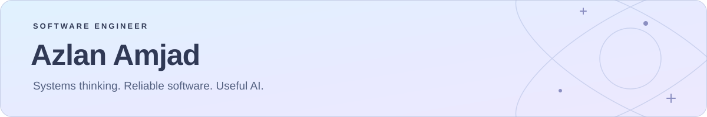

**Backend & distributed systems · Infrastructure · AI engineering**

I build reliable software across services, infrastructure, and intelligent
tools, with a focus on clear design, automation, and practical outcomes.

---

## ✨ Engineering domains

- 🤖 **AI & agentic engineering** — LLM-powered agents, developer tooling,
  and workflows that help teams put AI into practice.
- ☁️ **Backend & distributed systems** — APIs, data pipelines, and cloud services.
- ⚙️ **Infrastructure & reliability** — deployment automation, observability,
  and testing.
- 🌱 **Energy & embedded systems** — energy-management software, industrial IoT,
  and edge computing.

## 🛠️ Tools of the trade

**Languages**

**Services & AI**

**Cloud & reliability**

---

☁️ Thoughtful design · Practical automation · End-to-end ownership

